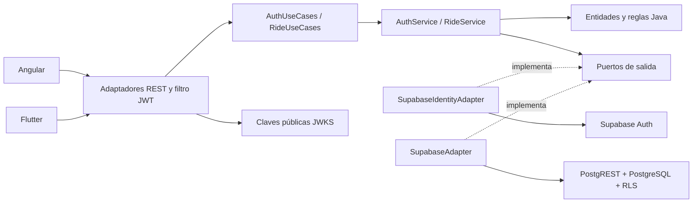

# RideMove · Entrega Angular + Spring Boot

Fecha: 28 de septiembre de 2026. Primer hito: **Login, Registro y Dashboard**.

El frontend web nuevo utiliza Angular 21 LTS y TypeScript estricto. El backend
Java 21 con Spring Boot implementa el hexágono y valida JWT emitidos por Supabase
Auth. PostgreSQL de Supabase conserva los datos, RLS y las funciones transaccionales.
La aplicación móvil Flutter existente se conserva como otro cliente de la API.
Angular no reemplaza el APK de Flutter.

## Qué se entrega

| Requisito | Implementación / evidencia | Límite de esta entrega |
|---|---|---|
| Backend primero | Casos de uso, adaptadores HTTP, JWT y pruebas en `backend/` | Despliegue público pendiente |
| Angular, tipado y sin `any` | `frontend/`, TypeScript strict, plantillas strict y `npm run check:types` | La API externa se tipa mediante DTO; la validación de negocio vive en Java |
| Login | POST `/api/auth/login`, JWT en memoria y renovación al recibir 401 | Se necesita un usuario válido y correo confirmado cuando Supabase lo exige |
| Registro | POST `/api/auth/register`, solo pasajero o conductor | La confirmación del correo depende de la configuración de Supabase |
| Dashboard | Perfil, resumen e historial consultados por HTTP, filtros y solicitud de viaje | Actualización manual; operación completa de conductor en Flutter |
| Base de datos | Adaptador a PostgREST + PostgreSQL de Supabase | No hace falta publicar la contraseña de PostgreSQL en ningún cliente |
| Arquitectura hexagonal | Dominio, aplicación, puertos, adaptadores y composición | ArchUnit verifica las dependencias de Java |
| SOLID y 12 factores | Matrices de evidencia en este documento | Varios factores operativos requieren infraestructura de despliegue |
| Pago en frontend | Botón en viajes finalizados del pasajero y diálogo accesible | Simulación explícita; sin tarifa, pasarela, cobro ni persistencia de pagos |
| HTTP | REST/JSON, Authorization Bearer, códigos HTTP y CORS por entorno | HTTP local; HTTPS al desplegar |
| Postman | Colección y entorno en `output/entrega_angular_spring/postman/` | Completar credenciales de prueba localmente; no se incluyen cuentas personales |
| Jira | CSV importable y libro Excel del backlog | No hay proyecto Jira creado ni tareas publicadas en una cuenta |
| Figma | Pantallas SVG editables, tokens y guía en `output/entrega_angular_spring/figma/` | Importación a Figma y conexiones del prototipo pendientes en la cuenta del equipo |
| Ramas | `main`, `preproduccion`, `produccion` locales | Sin remoto ni despliegue automático; una rama no equivale a un ambiente desplegado |

## Arranque local

Requisitos: Java 21, Maven 3.9+, Node compatible con Angular 21, npm y Git.
Se eligió Angular 21 LTS por compatibilidad con el Node 24.13 instalado.
La [tabla oficial de Angular](https://angular.dev/reference/versions) especifica
las versiones admitidas. Las dependencias exactas quedan en `package-lock.json`.

1. Copiar `backend/.env.example` a `backend/.env`. Completar `SUPABASE_URL` y
   `SUPABASE_ANON_KEY` con la URL y la clave pública del proyecto. En esta máquina
   también existe `config/supabase.json`, excluido de Git; el lanzador puede leerlo.
2. Configurar `CORS_ORIGINS` para el origen exacto de Angular, por ejemplo
   `http://127.0.0.1:4200`. El backend no abre CORS a todos los orígenes.
3. Compilar y arrancar en una terminal:

```powershell
mvn -f backend/pom.xml verify
./tools/start_backend.ps1
```

4. En otra terminal, arrancar Angular:

```powershell
./tools/start_frontend.ps1
```

El script copia `frontend/.env.example` si falta el archivo local y ejecuta
`npm ci` si faltan dependencias. Abrir `http://127.0.0.1:4200`.
`API_BASE_URL` define el backend. `DEMO_ENABLED=true` habilita un botón separado
para explorar con datos ficticios. En una entrega conectada usar `false`.
La configuración pública se genera en `frontend/public/config.json`, ignorado
por Git. No admite credenciales dentro de la URL ni HTTP remoto.

La aplicación web mantiene los tokens en memoria: recargar la página exige
iniciar sesión de nuevo. Los formularios reales siempre usan el backend;
el botón de demostración utiliza un adaptador de memoria identificado en pantalla.

## Configuración por ambiente

| Variable | Backend / frontend | Uso |
|---|---|---|
| `SUPABASE_URL` | Backend | Proyecto Supabase del ambiente |
| `SUPABASE_ANON_KEY` | Backend | Clave pública publishable o anon, nunca service_role para acciones de usuario |
| `PORT` | Backend | Puerto HTTP, por defecto 8080 |
| `CORS_ORIGINS` | Backend | Lista de orígenes web separados por coma |
| `JWT_ISSUER` | Backend, opcional | Por defecto `SUPABASE_URL/auth/v1` |
| `JWT_JWKS_URL` | Backend, opcional | Por defecto issuer + `/.well-known/jwks.json` |
| `JWT_AUDIENCE` | Backend | Audiencia esperada, authenticated |
| `API_BASE_URL` | Frontend | URL pública de la API |
| `DEMO_ENABLED` | Frontend | Activa el acceso explícito a la demostración |

Las URL, claves y valores dependientes del ambiente están fuera del código.
Los textos, colores y reglas de negocio son parte de la aplicación y sí se
versionan. Para promover el mismo build Angular, sustituir únicamente el archivo
público `config.json` durante la fase de release. Nunca poner secretos en ese JSON.

Crear proyectos Supabase independientes para preproducción y producción antes
de publicar. Actualmente solo se ha configurado el proyecto suministrado; no se
inventan ambientes adicionales. Las migraciones de `supabase/migrations` se
ejecutan en orden en bases nuevas. No repetir las ya aplicadas sobre la base actual.

## Arquitectura y JWT



Login y registro reciben JSON. Supabase verifica las contraseñas y emite tokens;
Java no almacena contraseñas. El filtro de Spring Security verifica firma ES256
o RS256, emisor, vigencia, audiencia y un sujeto UUID. La implementación usa el
[resource server JWT de Spring Security](https://docs.spring.io/spring-security/reference/servlet/oauth2/resource-server/jwt.html).
Un JWT manipulado no permite entrar a los controladores de negocio.

El sujeto verificado identifica al actor. Su rol y estado activo se consultan en
`profiles`; no se confía en un rol enviado por el navegador. Los casos de uso
autorizan cada operación. El adaptador envía el JWT del usuario a Supabase,
manteniendo RLS y verificaciones de concurrencia en las funciones de la base.

El interceptor Angular envía Bearer exclusivamente a la API configurada. Ante
401 renueva la sesión una vez y reintenta; si falla la renovación, vuelve al
login. Logout revoca la sesión de renovación en Supabase y limpia la memoria
local incluso si la red falla. Un access token ya emitido puede seguir siendo
válido hasta su expiración: no se implementa una lista de revocación en Java.
El registro nunca permite crear un administrador desde el frontend.

## SOLID, con ejemplos del código

| Principio | Aplicación concreta |
|---|---|
| S · Responsabilidad única | Controladores traducen HTTP; servicios ejecutan casos de uso; adaptadores acceden a Supabase. Login, registro, lista de viajes y diálogo de pago son componentes separados. |
| O · Abierto/cerrado | Se puede añadir otro adaptador de persistencia implementando los puertos sin modificar las reglas de `Trip` o los casos de uso. |
| L · Sustitución | Las pruebas de casos de uso sustituyen puertos con dobles. En Angular los adaptadores HTTP y demo cumplen `RideGateway`. |
| I · Segregación | `ProfilePort`, `TripPort`, `VehiclePort`, `LocationPort` e `IdentityPort` separan contratos por capacidad. |
| D · Inversión de dependencias | La aplicación Java depende de interfaces, no de Spring, RestClient ni Supabase. `bootstrap` ensambla implementaciones. |

## Los 12 factores

Referencia: [The Twelve-Factor App](https://12factor.net/es/).
La tabla distingue código preparado de operación desplegada; no certifica un
servicio que todavía no está publicado.

| Factor | Evidencia y trabajo restante |
|---|---|
| 1. Código base | Un repositorio Git; clientes y API organizados en carpetas. Ramas locales para promoción. Falta remoto del equipo. |
| 2. Dependencias | `pom.xml`, `package.json` + lockfile, `pubspec.yaml` + lockfile. No depender de librerías copiadas a mano. |
| 3. Configuración | Variables de entorno y plantillas `.env.example`; archivos reales excluidos de Git. |
| 4. Servicios de apoyo | Supabase se conecta por URL y clave del ambiente. Puede cambiarse sin cambiar el dominio. |
| 5. Construir, entregar, ejecutar | Maven y Angular generan artefactos; configuración se aporta al release; JAR o Docker ejecutan API. Automatizar promoción en CI/CD queda pendiente. |
| 6. Procesos | API sin sesión de servidor. Datos persistentes en PostgreSQL; caché de claves JWKS no contiene datos del usuario. |
| 7. Asignación de puertos | Spring Boot expone HTTP mediante `PORT`. Angular se sirve como archivos estáticos. |
| 8. Concurrencia | API preparada para réplicas y DB con bloqueos/restricciones para viajes. No se ha probado escalado horizontal ni carga. |
| 9. Desechabilidad | Apagado ordenado configurado con 20 segundos de espera. El orquestador y sus señales deben validarse en despliegue. |
| 10. Paridad desarrollo/producción | Mismas migraciones y runtimes declarados. Faltan proyectos, dominios y secretos distintos por ambiente. |
| 11. Historiales | Spring escribe en stdout/stderr. No se registran tokens ni contraseñas desde el código añadido. Falta agregador y retención en infraestructura. |
| 12. Administración | Migraciones SQL y pruebas transaccionales versionadas, ejecutadas como tareas puntuales. Automatizar releases de esquema queda pendiente. |

## Trabajo de dos personas

**Responsable backend:** modelo y reglas, migraciones/RLS, contratos REST, JWT,
pruebas Java, colección Postman, contenedor y configuración. Primero cierra el
contrato de Login, Registro y Dashboard con ejemplos y códigos HTTP.

**Responsable frontend:** pantallas Figma, Angular, formularios tipados,
consumo HTTP, sesión y estados de carga/error/vacío. Implementa el botón de pago
demo y pruebas del navegador después de revisar los contratos del backend.

Ambos revisan aceptación, integración, accesibilidad y promoción de ramas.
Los nombres reales se asignan en Jira; el backlog no inventa personas ni fechas.
Las estimaciones de puntos son propuestas del plan, no tiempo ya trabajado.

## IntelliJ IDEA o Visual Studio Code

En IntelliJ: abrir `backend/pom.xml`, seleccionar JDK 21, importar Maven y crear
una configuración de `RideMoveServer` con variables de entorno. El soporte visual
de Spring depende de la edición; el comando Maven funciona sin él.
En VS Code: abrir la raíz, usar extensiones Java y Angular si se desea, y ejecutar
los lanzadores en dos terminales. No hay dependencia obligatoria de un IDE.

## Postman y presentación de las tres funciones

Importar colección y entorno desde la carpeta `postman`. Completar localmente
`email`, `password` y `name`; usar una cuenta destinada a pruebas.
Ejecutar primero salud y acceso sin JWT (401), luego registro (puede requerir
confirmación por correo), login y consultas de perfil/viajes. Los scripts guardan
access y refresh token solo en el entorno activo. No compartir su exportación
después de probar sin borrar esos valores.

Las peticiones que crean o modifican datos están en una carpeta separada, con
descripciones de precondiciones. No ejecutar toda la colección contra datos de
usuarios como una prueba automática. No hay endpoint de pagos porque la pasarela
todavía no se ha elegido.

Guion de demostración: registrar una cuenta; confirmar correo si aplica; iniciar
sesión; mostrar el perfil e historial reales; solicitar viaje; actualizar el panel;
cerrar sesión y comprobar que `/dashboard` redirige al login. Para presentar el
pago visual sin crear viajes reales, usar «Explorar demostración» y un viaje finalizado.

## Ramas y promoción

Se usa `main` en minúsculas como rama principal. `preproduccion` y `produccion`
parten de la misma base local; eso no significa que existan servidores publicados.
Crear ramas `feature/...` desde main, integrar mediante revisión y pruebas,
promover el commit aprobado a preproduccion y después a produccion.

```powershell
git switch main
git switch -c feature/nombre-corto
# desarrollar, probar y abrir revisión cuando exista remoto
git switch preproduccion
git merge --ff-only main
# probar en el ambiente de preproducción antes de promover
git switch produccion
git merge --ff-only preproduccion
```

Las protecciones de rama, revisiones obligatorias y credenciales de despliegue se
configuran cuando exista el repositorio remoto del equipo. No se ha publicado ni
fusionado nada en servicios externos.

## Comprobaciones reproducibles

```powershell
mvn -f backend/pom.xml verify
cd frontend
npm ci
npm run build
npm test
npm run check:types
```

Java incluye reglas de negocio, límites de arquitectura, JWT, HTTP y adaptadores.
Angular cubre configuración, aislamiento del token, renovación, confirmación por
correo, cambio entre demo y cuenta real, y limpieza al salir. La evidencia de la
ejecución local queda en `output/entrega_angular_spring/VALIDACION.md`.

## Pendientes para una entrega publicada

Elegir alojamiento y dominios HTTPS, crear ambientes de base separados, configurar
SMTP/confirmación de correo, proteger ramas, añadir CI/CD, pruebas de carga y
observabilidad. Para cobros reales se requiere definir tarifa, moneda y pasarela,
implementar orden en backend, webhooks verificados, idempotencia, estados de pago
y pruebas sandbox. No introducir claves privadas de pagos en Angular.

Los SVG y el CSV son entregables importables. El equipo debe crear el archivo
Figma y el proyecto Jira en sus cuentas, importar y asignar personas. Esta entrega
no afirma haber realizado esas acciones externas.
