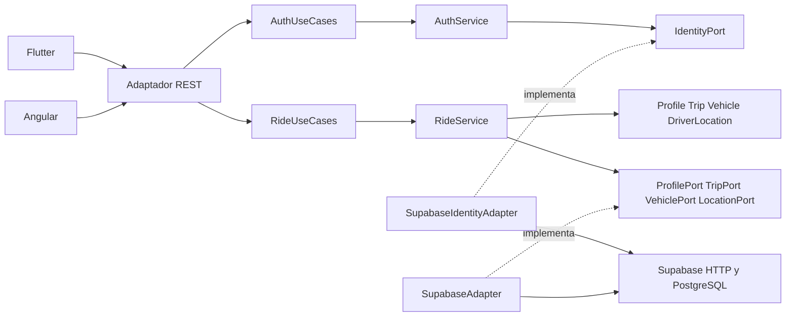

# Arquitectura hexagonal de RideMove

El hexágono es el backend Java. Angular y Flutter son clientes REST y Supabase aporta
identidad, PostgreSQL, políticas RLS y funciones atómicas. La autenticación móvil
usa Supabase Auth directamente; Angular utiliza los endpoints `/api/auth` del
backend. Todas las operaciones de negocio pasan por la API. Spring Security
valida la firma y los claims JWT con claves públicas JWKS antes de crear el
caso de uso autenticado. Ver la entrega actualizada en [ENTREGA.md](ENTREGA.md).

Las flechas dentro del backend representan dependencias de código. El dominio
no depende de los puertos de aplicación ni de ningún framework. La configuración
construye un adaptador autenticado por solicitud e inyecta las implementaciones.

Las reglas de autoría, rol, estados, calificación y disponibilidad se comprueban
en las entidades y casos de uso Java. La persistencia vuelve a comprobar las
condiciones sensibles a carreras mediante bloqueo de filas e índices únicos.
No se utiliza una clave service_role para las operaciones de los usuarios.

Las pruebas ArchUnit fallan si dominio o aplicación importan Spring, adaptadores,
configuración o Jackson. Las pruebas con Mockito sustituyen los puertos sin
usar red. La prueba SQL transaccional verifica integridad y aislamiento real.

La versión de demostración de Flutter utiliza memoria temporal y no pretende
reemplazar las garantías de autorización del backend y PostgreSQL.
