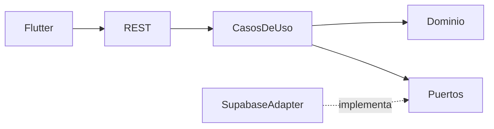

# RideMove

Documento consolidado del proyecto y arquitectura hexagonal

Laura Camila Díaz Rey
Fabián Sneider Martínez Moreno

Gestor del conocimiento
Luis Ferney Ortiz Parra

Universidad de Cundinamarca
Ingeniería de Sistemas y Computación
Ingeniería de Software I
2026-2

Versión 2.0
22 de septiembre de 2026

Este documento actualiza IS V1 y el primer comité de arquitectura. Conserva el problema, los actores y los requisitos funcionales de RideMove, y describe la implementación con Flutter, Java 21 y Supabase. La arquitectura hexagonal se aplica al backend mediante entidades, casos de uso, puertos y adaptadores comprobables en el código.

# Control de cambios y contenido

La versión inicial proponía React y Spring Boot sobre PostgreSQL. Por decisión del solicitante, Flutter reemplaza el frontend web y Supabase proporciona autenticación y PostgreSQL administrado. Java y Spring Boot se mantienen como backend para cumplir el lineamiento de arquitectura hexagonal y comunicación mediante HTTP.

Esta revisión no modifica los PDF originales ni afirma aprobación del comité. La entrega describe los cambios técnicos realizados y conserva los objetivos académicos del proyecto.

Sección | Contenido
--- | ---
1 y 2 | Introducción, problema, objetivos, actores y alcance
3 | Enfoque iterativo incremental y Scrum
4 | Requisitos funcionales, no funcionales y prioridades
5 y 6 | Dependencias, tecnologías y arquitectura hexagonal
7 | Riesgos y medidas de tratamiento
8 | Modelo relacional y diccionario de datos
9 | Conclusiones, validación y condiciones de ejecución
Anexos | Contrato HTTP, trazabilidad y referencias

# 1 Introducción del proyecto

En Fusagasugá, parte del transporte urbano y semiurbano se coordina mediante grupos de WhatsApp y llamadas. Las solicitudes pueden perderse entre mensajes y dependen de que un conductor responda oportunamente. El pasajero tiene poca claridad sobre el estado del servicio y los participantes no cuentan con un historial centralizado.

RideMove organiza ese proceso mediante una aplicación móvil. El pasajero registra origen y destino, los conductores disponibles consultan las solicitudes y uno acepta el servicio. La plataforma registra los cambios de estado y permite calificar el viaje al finalizar.

La solución se divide en aplicación móvil, backend de negocio y servicios de datos. Flutter presenta las pantallas y administra la interacción con el GPS. La API Java ejecuta los casos de uso. Supabase administra las identidades, los datos persistentes y las restricciones transaccionales.

## Objetivo general

Desarrollar una primera versión funcional de RideMove que permita solicitar, atender, seguir y calificar servicios de transporte en Fusagasugá, con control por roles y un backend cuya lógica sea independiente de los frameworks y de la persistencia.

## Objetivos específicos

Registrar solicitudes con origen y destino. Permitir al conductor gestionar su disponibilidad y atender solicitudes. Consultar el estado y la ubicación compartida durante el servicio. Conservar historial y calificaciones. Dar al administrador herramientas básicas de supervisión y gestión de usuarios y vehículos.

# 2 Descripción general del sistema

## Problema y flujo de servicio

La coordinación manual dispersa la información y obliga a confirmar el servicio por varios canales. RideMove centraliza el flujo: solicitud pendiente, aceptación por un conductor, inicio del viaje, finalización y calificación. El pasajero puede cancelar mientras la solicitud siga pendiente.

## Usuarios del sistema

Actor | Necesidad y capacidades
--- | ---
Pasajero | Registrar y editar su perfil. Solicitar o cancelar un servicio pendiente. Consultar estado, conductor asignado, vehículo y mapa. Calificar su viaje finalizado.
Conductor | Registrar perfil, licencia y vehículo. Activar disponibilidad. Consultar, aceptar o rechazar solicitudes. Iniciar y finalizar el viaje. Compartir ubicación durante un servicio activo.
Administrador | Consultar usuarios, conductores, vehículos y servicios. Suspender o reactivar usuarios cuando no tienen servicios activos. Corregir información de vehículos. Revisar conteos generales.

## Alcance de la primera versión

Incluye autenticación, perfil, servicios, historial, calificaciones, mapa del conductor y gestión básica. Se registra un vehículo actual por conductor y la última ubicación enviada. No incluye pagos electrónicos, integración bancaria, tarifas automáticas complejas ni asignación por inteligencia artificial.

La ubicación se actualiza en primer plano al desplazarse el conductor, con consentimiento explícito. Se detiene al salir de la app o finalizar el viaje. El seguimiento en segundo plano no forma parte de esta entrega.

# 3 Enfoque metodológico

## Enfoque iterativo incremental

Los requisitos del flujo principal son estables, pero la interfaz, la gestión administrativa y los detalles de ubicación requieren validación con los usuarios y el docente. El proyecto se organiza mediante entregas pequeñas que permiten revisar las reglas y corregir decisiones técnicas sin reconstruir todo el sistema.

## Scrum como marco de trabajo

El equipo está conformado por Laura Camila Díaz Rey y Fabián Sneider Martínez Moreno. Se propone trabajar con sprints de una a dos semanas. La planificación selecciona requisitos del backlog, el seguimiento diario revisa impedimentos, la revisión demuestra un incremento y la retrospectiva identifica mejoras. Estas actividades son el plan metodológico y no constituyen un registro de ceremonias ya realizadas.

## Backlog por valor funcional

Incremento | Objetivo | Criterio de revisión
--- | --- | ---
Usuarios | Registro, sesión y perfil | Cada rol accede a las funciones permitidas.
Servicios | Solicitud y atención del viaje | Un servicio recorre los estados válidos y conserva historial.
Seguimiento | GPS y mapa | El pasajero asignado consulta la ubicación del viaje activo.
Calidad y administración | Calificaciones, gestión y pruebas | Las reglas se prueban sin depender de Supabase y se verifican en PostgreSQL.

# 4 Requisitos funcionales

Se conserva la codificación del documento inicial. La cancelación de una solicitud pendiente complementa RF-02 y la visualización del mapa concreta el seguimiento de RF-07.

Código | Requisito | Criterio funcional | Prioridad
--- | --- | --- | ---
RF-01 | Gestión de perfil | Pasajero y conductor consultan y actualizan nombre y teléfono. | Media
RF-02 | Solicitud de servicio | El pasajero informa lugares diferentes de origen y destino y crea un viaje pendiente. | Alta
RF-03 | Disponibilidad | El conductor activa o desactiva su disponibilidad. Para activarla necesita un vehículo registrado. | Alta
RF-04 | Consulta de solicitudes | El conductor consulta solicitudes pendientes que no ha rechazado. | Alta
RF-05 | Aceptación o rechazo | Un conductor disponible acepta una solicitud. El rechazo la oculta para ese conductor y permite que otros la atiendan. | Alta
RF-06 | Actualización del estado | El conductor asignado inicia el viaje aceptado y finaliza el viaje en curso. | Alta
RF-07 | Consulta y seguimiento | El pasajero ve estado, nombre del conductor, vehículo y última ubicación compartida durante el viaje activo. | Alta
RF-08 | Calificación | Solo el pasajero propietario califica una vez un servicio finalizado, de 1 a 5, con comentario opcional. | Media
RF-09 | Gestión administrativa | El administrador consulta servicios y usuarios, cambia su acceso y edita vehículos de conductores. | Media

# 4 Requisitos no funcionales

Los criterios siguientes distinguen lo implementado de los objetivos que requieren mediciones adicionales. Una prueba unitaria no demuestra por sí sola el rendimiento de la plataforma en producción.

Categoría | Criterio de aceptación | Evidencia o límite
--- | --- | ---
Seguridad de credenciales | Delegar las contraseñas a Supabase Auth y no almacenarlas en perfiles ni en la app. | La app usa clave pública y tokens de sesión. El backend no necesita la contraseña de PostgreSQL para operar.
Control de acceso | Validar identidad, rol, propiedad del servicio y estado de la cuenta. | Validación de token por Auth, reglas Java y RLS en PostgreSQL. Pruebas de acceso no autorizado.
Rendimiento | Responder las operaciones principales en un máximo de 3 segundos bajo condiciones normales. | Objetivo conservado. Pendiente medición con usuarios y red reales. El refresco de pantalla se realiza cada 10 segundos.
Escalabilidad | Permitir crecimiento manteniendo consistencia de asignación. | Índices y restricciones únicas. La API actual conserva el límite de lectura de PostgREST; paginación e indicadores masivos requieren ampliación.
Mantenibilidad | El núcleo no depende de Spring, HTTP, Flutter ni Supabase. | Pruebas ArchUnit verifican las dependencias del dominio y los casos de uso.
Usabilidad | Solicitar un servicio en no más de tres pasos. | Escribir origen, escribir destino y pulsar Solicitar. Prueba de interfaz de 390 píxeles de ancho.

# 5 Dependencias del proyecto

La infraestructura externa se utiliza mediante adaptadores y configuración. La disponibilidad de internet condiciona la autenticación, la consulta de servicios, los mapas y la sincronización de ubicación.

Dependencia | Uso e impacto
--- | ---
Flutter y Dart | Aplicación móvil y acceso al GPS. Impacto alto para el cliente.
Java 21 y Spring Boot 3.5.16 | API HTTP, configuración y ejecución del backend. Impacto alto. La versión indicada corresponde al artefacto compilado.
Supabase Auth | Registro, confirmación de correo, inicio y renovación de sesión. Impacto alto.
PostgreSQL administrado por Supabase | Datos, transacciones, restricciones y RLS. Impacto alto. No se presupone una versión mayor sin consultar el proyecto.
PostgREST y funciones RPC | Adaptador HTTP de persistencia que conserva el token del usuario. Impacto alto.
flutter_map y OpenStreetMap | Mapa con atribución visible. Impacto medio. Los mosaicos requieren internet.
Maven y Flutter SDK | Compilación, análisis y pruebas reproducibles. Java 21 disponible en el equipo de trabajo.
Git y repositorio remoto | Control de versiones previsto. La carpeta suministrada no tenía un repositorio Git inicializado; no se afirma publicación remota.

# 6 Arquitectura hexagonal

El núcleo de negocio reside en backend/src/main/java/co/ridemove. Las entidades Profile, Trip, Vehicle y DriverLocation definen información y reglas. RideService implementa el puerto de entrada RideUseCases y depende únicamente de puertos de salida.

El controlador REST traduce las solicitudes HTTP a llamadas de casos de uso. SupabaseAdapter implementa ProfilePort, TripPort, VehiclePort y LocationPort. La configuración conecta estas piezas e identifica al usuario autenticado. El núcleo puede probarse con sustitutos en memoria o Mockito sin arrancar Spring ni acceder a la base de datos.

## Dirección de las dependencias

El dominio depende de Java estándar. La aplicación depende del dominio y de sus interfaces. Los adaptadores dependen de esas interfaces. La configuración conoce las implementaciones concretas para construir el sistema. Flutter funciona como cliente de la API REST y Supabase Auth conserva la gestión de identidad.

Las funciones SQL repiten las reglas sensibles al estado concurrente. Son una garantía de integridad en la persistencia; los casos de uso Java validan previamente las reglas del negocio.

# 6 Reglas y estados del servicio

Las operaciones verifican el rol y la propiedad antes de escribir. La base de datos repite la comprobación dentro de la transacción para cubrir cambios ocurridos después de la lectura del backend.

Estado inicial | Acción y actor | Estado final
--- | --- | ---
Pendiente | Conductor disponible acepta | Aceptado
Pendiente | Pasajero propietario cancela | Cancelado
Aceptado | Conductor asignado inicia | En curso
En curso | Conductor asignado finaliza | Finalizado
Finalizado | Pasajero propietario califica | Finalizado con calificación

## Consistencia y concurrencia

Un índice parcial impide más de un viaje activo por pasajero. Otro impide dos viajes aceptados o en curso por conductor. La función transition_trip bloquea la fila del viaje antes de asignarlo y verifica su estado. Dos conductores no pueden aceptar con éxito la misma solicitud.

El rechazo se registra por solicitud y conductor. No cambia el estado global del viaje. La calificación acepta enteros de 1 a 5, exige viaje finalizado y rechaza una segunda calificación.

La ubicación solo puede enviarse durante un viaje aceptado o en curso. RLS permite verla al conductor, al pasajero asignado y al administrador. El pasajero pierde acceso al finalizar el servicio.

# 7 Riesgos del proyecto

Riesgo | Nivel | Tratamiento y validación pendiente
--- | --- | ---
Errores de GPS o permisos denegados | Medio | Solicitar permiso, informar el fallo y permitir detener el envío. Validar precisión y consumo en un teléfono físico.
Exposición de datos o escalamiento de roles | Alto | Auth valida tokens, el rol se lee de profiles y RLS limita filas. El registro público no permite crear administradores.
Asignación concurrente | Alto | Bloqueo transaccional y restricciones únicas. Las pruebas actuales verifican flujo y duplicados; queda pendiente una prueba de carga concurrente.
Dependencia de internet y servicios externos | Alto | Tiempos de espera finitos, mensajes de error y actualización manual. No se ofrece operación de transporte sin conexión.
Complejidad técnica y tiempo del equipo | Alto | Separar responsabilidades, conservar pruebas de arquitectura y priorizar RF-02 a RF-07.
Cambios del comité | Medio | Revisión por incremento y actualización de la matriz de requisitos. La aprobación académica corresponde al comité.
Disponibilidad pública del backend | Alto | Entregar ejecutable y Dockerfile. El backend local necesita alojamiento HTTPS para que el APK funcione fuera de la red de desarrollo.

# 8 Modelo de base de datos

La implementación utiliza cinco tablas públicas y auth.users, administrada por Supabase Auth. Los identificadores de usuario son UUID. Los nombres físicos se conservan en inglés para coincidir con las migraciones y el adaptador; los nombres de las entidades del informe inicial se mapean explícitamente a continuación.

auth.users 1 a 1 profiles
profiles 1 a 0..1 vehicles y locations
profiles 1 a N trips como pasajero y conductor
trips y profiles N a M mediante rejections

Entidad del informe inicial | Implementación física y decisión
--- | ---
USUARIO | auth.users administra identidad y contraseña; profiles conserva nombre, teléfono, rol y acceso.
CONDUCTOR | Especialización mediante profiles.role y profiles.available; la licencia está en vehicles.
VEHICULO | vehicles conserva el vehículo actual de cada conductor. Un conductor tiene como máximo un registro vigente.
UBICACION | locations conserva la última coordenada y fecha. No constituye un historial de recorridos.
SOLICITUD | trips relaciona pasajero y conductor, con estados y fechas.
CALIFICACION | rating y comment en trips. Una calificación por viaje.
RECHAZO | rejections registra la relación solicitud-conductor rechazada.

# 8 Diccionario de datos de usuarios y vehículos

Tabla y campo | Tipo | Restricción y significado
--- | --- | ---
profiles.id | uuid | PK y FK a auth.users.id. Eliminación en cascada desde identidad.
profiles.name | text | Obligatorio, de 2 a 80 caracteres. Nombre del usuario.
profiles.phone | text | Hasta 25 caracteres. Teléfono de contacto; puede estar vacío.
profiles.role | text | passenger, driver o admin. El registro solo acepta passenger o driver.
profiles.active | boolean | Control del acceso a la plataforma. Valor inicial true.
profiles.available | boolean | Disponibilidad del conductor. Valor inicial false.
vehicles.driver_id | uuid | PK y FK a profiles.id. Identifica al propietario y limita a un vehículo actual.
vehicles.plate | text | Placa única, de 3 a 10 caracteres. Se normaliza a mayúsculas.
vehicles.brand | text | Marca de 1 a 40 caracteres.
vehicles.model | text | Modelo o año de 1 a 20 caracteres.
vehicles.color | text | Color de 1 a 30 caracteres.
vehicles.license | text | Licencia de conducción de 1 a 40 caracteres.

# 8 Diccionario de datos de viajes

Campo de trips | Tipo | Restricción y significado
--- | --- | ---
id | uuid | PK generada por PostgreSQL.
passenger_id | uuid | FK a profiles.id. Pasajero que solicitó el servicio.
driver_id | uuid o null | FK a profiles.id. Se asigna al aceptar.
origin | text | Lugar de recogida, de 3 a 150 caracteres.
destination | text | Destino de 3 a 150 caracteres, diferente del origen.
status | text | pending, accepted, in_progress, completed o cancelled.
created_at | timestamptz | Fecha de solicitud; valor inicial now().
completed_at | timestamptz o null | Fecha obligatoria solo cuando el estado es completed.
rating | integer o null | Valor de 1 a 5. Solo para un servicio finalizado.
comment | text o null | Comentario opcional de hasta 255 caracteres.

## Integridad del viaje

Las claves foráneas conservan la relación con las personas. Los índices one_active_passenger_trip y one_active_driver_trip impiden servicios activos incompatibles. El estado y la fecha de finalización deben ser consistentes. Las transiciones y la autoría de la calificación se controlan mediante RPC.

# 8 Diccionario de ubicación y rechazo

Tabla y campo | Tipo | Restricción y significado
--- | --- | ---
locations.driver_id | uuid | PK y FK a profiles.id. Un último punto por conductor.
locations.latitude | double precision | Latitud entre -90 y 90.
locations.longitude | double precision | Longitud entre -180 y 180.
locations.updated_at | timestamptz | Fecha de la última actualización.
rejections.trip_id | uuid | FK a trips.id. Parte de la PK compuesta.
rejections.driver_id | uuid | FK a profiles.id. Parte de la PK compuesta.

## Políticas de acceso

Todas las tablas públicas tienen RLS. Los clientes autenticados reciben SELECT y acceso a funciones específicas, sin INSERT, UPDATE ni DELETE directos. Los pasajeros consultan sus viajes; los conductores consultan los asignados y las solicitudes pendientes no rechazadas. Administración tiene visibilidad general.

auth.users es propiedad de Supabase Auth. La contraseña no se replica en profiles ni se almacena como texto en la app. No se incluyen credenciales privadas en este documento.

## Migraciones

202609180001_initial.sql crea el esquema inicial. 202609220001_hexagonal_support.sql añade la edición administrativa de vehículos y refuerza calificaciones, ubicación y coherencia temporal. La segunda migración se aplica una sola vez después de la primera.

# Anexo A Contrato HTTP

Las operaciones de negocio requieren Authorization: Bearer con un token de Supabase Auth. El backend verifica el token con Auth y utiliza el identificador validado. No acepta roles enviados por la aplicación como autorización. GET /health es público y solo indica que el proceso está activo.

Método | Ruta | Propósito
--- | --- | ---
GET | /api/profile | Perfil propio
GET | /api/profiles | Usuarios visibles por rol
GET | /api/trips | Solicitudes e historial visibles
GET | /api/vehicles | Vehículos visibles
GET | /api/locations | Últimas posiciones autorizadas
POST | /api/trips | Crear solicitud
PUT | /api/trips/{id}/status | Aceptar, cancelar, iniciar o finalizar
POST | /api/trips/{id}/rejections | Rechazar para el conductor actual
POST | /api/trips/{id}/rating | Calificar el servicio
PUT | /api/profile | Actualizar perfil
PUT | /api/availability | Cambiar disponibilidad
PUT | /api/profiles/{id}/access | Administrar acceso
PUT | /api/vehicle | Guardar vehículo propio o administrado
PUT | /api/location | Enviar posición durante servicio activo

Respuestas: 200 para operaciones exitosas, 201 para crear solicitud, 400 para datos mal formados, 401/403 para acceso no autorizado, 409 para reglas de negocio o conflicto de estado, y 503 cuando la dependencia externa no responde.

# Anexo B Trazabilidad de requisitos

Requisito | Caso de uso en RideService | Evidencia de implementación
--- | --- | ---
RF-01 | profile y saveProfile | Perfil Flutter, puerto ProfilePort y RPC save_profile.
RF-02 | createTrip | Formulario Flutter, validación del destino y prueba de duplicados.
RF-03 | setAvailability | Interruptor Flutter, requisito de vehículo y RPC atómica.
RF-04 | trips | Lectura filtrada por RLS y exclusión de rechazos.
RF-05 | transitionTrip y rejectTrip | Reglas de rol, vehículo, disponibilidad y bloqueo en PostgreSQL.
RF-06 | transitionTrip | Trip.validateTransition y pruebas de secuencia de estados.
RF-07 | trips y locations | Mapa OpenStreetMap, LocationTracker y puerto LocationDevice.
RF-08 | rateTrip | Trip.validateRating, validación de rango y prueba de autoría.
RF-09 | profiles, setActive y saveVehicle | Panel administrativo, restricciones sobre viajes activos y edición de vehículos.

## Pruebas y evidencia

La suite Java contiene 24 pruebas que verifican reglas, arquitectura, HTTP y el adaptador de persistencia. Las pruebas Flutter cubren la interfaz móvil, el flujo de demostración, los duplicados y la parada del GPS. El script supabase/tests/workflow.sql verifica un flujo real y el aislamiento RLS dentro de una transacción que revierte sus datos de prueba.

# 9 Conclusiones y condiciones de ejecución

RideMove conserva el alcance funcional principal definido en IS V1. La incorporación del backend Java convierte la separación de capas inicial en una arquitectura hexagonal verificable: los casos de uso utilizan interfaces y las tecnologías externas quedan en adaptadores. Flutter mantiene el cliente móvil solicitado y Supabase conserva la autenticación y PostgreSQL.

Las comprobaciones realizadas permiten revisar reglas de negocio, estructura de dependencias, aislamiento de datos y compilación. No equivalen a una certificación de rendimiento, seguridad integral o usabilidad con usuarios reales.

## Ejecución y despliegue

El backend requiere Java 21 y las variables SUPABASE_URL y SUPABASE_ANON_KEY. tools/start_backend.ps1 inicia el JAR usando el archivo local de configuración. La app requiere API_BASE_URL. Para el emulador Android la dirección del equipo anfitrión es http://10.0.2.2:8080; un teléfono físico necesita una dirección de red accesible o una API HTTPS alojada.

La entrega incorpora Dockerfile y ejecutable Java. No se afirma despliegue público del backend. La versión iOS requiere compilación y firma desde macOS. El APK de depuración permite pruebas; una distribución pública necesita firma de publicación y configuración HTTPS.

## Validaciones pendientes

Medición del objetivo de tres segundos con red y usuarios reales. Prueba de carga y concurrencia. Validación del GPS, permisos y batería en un dispositivo físico. Revisión académica de los cambios tecnológicos. Paginación de grandes historiales y revisión de operación pública del servicio.

## Referencias

Fuentes del proyecto: IS V1.pdf, páginas 3 a 23, y Comité.pdf, páginas 1 a 9. Código, migraciones y pruebas del repositorio RideMove, revisión del 22 de septiembre de 2026.

Documentación técnica: docs.spring.io/spring-boot/3.5/system-requirements.html; supabase.com/docs; docs.fleaflet.dev; openstreetmap.org/copyright.
